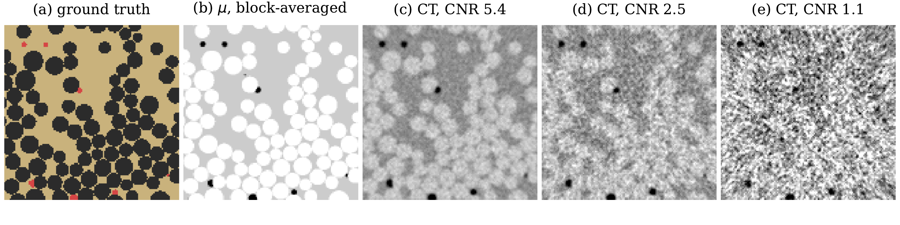
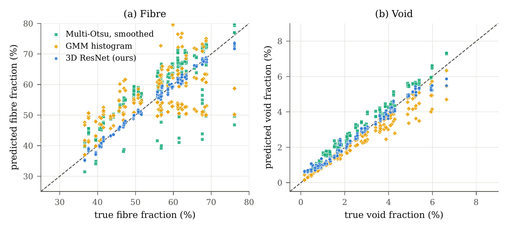

# Composite phase fractions from X-ray CT with a 3D CNN

Predict the **fibre, matrix and void volume fractions** of a fibre-composite sub-volume directly from its X-ray CT
image, with no voxel segmentation, and compare the result against classical counting methods on identical data.

PHC-351 course project (Project 65), Department of Physics, IIT Roorkee, Autumn 2026.
Author: Abhinav Swaran Singh. Supervisor: Prof. Mayank Goswami.

<p align="center"></p>

## Results

216 test crops (64³ voxels) from 9 held-out composites, 3 X-ray doses. MAE in percentage points (pp), 95% cluster-bootstrap CI.

| Method | Fibre MAE (pp) | Fibre R² | Void MAE (pp) | Void R² |
|---|---|---|---|---|
| **3D ResNet (this work)** | **0.84** [0.66, 1.05] | **0.988** | **0.17** [0.11, 0.25] | **0.977** |
| Multi-Otsu, raw | 9.79 [7.24, 12.42] | −0.75 | 5.37 [2.48, 8.76] | −33.8 |
| Multi-Otsu, smoothed | 6.06 [4.72, 7.39] | 0.54 | 2.78 [0.50, 5.94] | −19.2 |
| Gaussian mixture | 8.02 [6.26, 9.87] | 0.03 | 0.28 [0.13, 0.44] | 0.917 |

* Fibre and matrix: better than every baseline on all 9 test composites (paired Wilcoxon, p = 0.0039, the minimum for n = 9).
* Fibre error stays near 1 pp as the contrast-to-noise ratio falls from 5.2 to 1.2 (raw Otsu: 2.8 → 19 pp).
* Void: not significantly different from the Gaussian mixture (p = 0.36); over-estimates void below 1%.
* A calibrated mean-grey-value estimator reaches 1.09 pp, but a 2% calibration error raises it to 8.4 pp; the network is unaffected.
* 3 seeds: fibre MAE 0.90 ± 0.06 pp. Shuffled-label control: 8.88 pp, so no leakage between splits.

<p align="center"></p>

## Repository layout

```
src/
  phantom.py       synthetic composites: force-biased fibre packing, log-normal voids, exact 2x-supersampled truth
  ct_sim.py        CT simulation with the ASTRA Toolbox: projection, Poisson noise, detector blur, FBP
  make_dataset.py  builds the dataset from one master seed; split by composite (42/9/9 + 6 out-of-distribution)
  model.py         3D ResNet regressor (3.6 M parameters, softmax output) and void-weighted loss
  train.py         training on random 64³ crops, mixed precision, auto-resume, shuffled-label option
  baselines.py     multi-Otsu counting and Gaussian-mixture histogram fit
  evaluate.py      metrics, cluster-bootstrap CIs, Bland-Altman plots
  experiments.py   error vs crop size, void level, packing density and dose
  stats.py         paired Wilcoxon tests and seed statistics
  meangrey.py      mean-grey-value baseline and calibration-error test
  regen_split.py   regenerates selected composites from the master seed
  tests.py         ground-truth checks (must print ALL PASS)
notebooks/Project65_Colab.ipynb   runs the whole pipeline on Google Colab
weights/resnet3d_c64_seed0.pt     trained model (state_dict, seed 0)
results/                          metrics, predictions, experiments, statistics, training log
figures/                          figures used in the paper and presentation
```

## Run it

**Google Colab (recommended).** Open `notebooks/Project65_Colab.ipynb` in Colab, select a T4 GPU and choose
*Run all*. It stores data and checkpoints in `MyDrive/project65/` and resumes after a disconnect.
The full run takes about 1.5 hours on a T4.

**Locally**
```bash
pip install -r requirements.txt
cd src
python tests.py                                   # must print ALL PASS
python make_dataset.py --out ../data --n 60 --n_ood 6
python train.py --data ../data --out ../runs/c64
python evaluate.py --data ../data --ckpt ../runs/c64/best.pt --out ../runs/c64/eval_test_c64
```
Run any script with `--help` for its options.

**Use the trained model**
```python
import sys, numpy as np, torch
sys.path.insert(0, "src")
from model import PhaseFractionResNet3D

model = PhaseFractionResNet3D()
model.load_state_dict(torch.load("weights/resnet3d_c64_seed0.pt", map_location="cpu"))
model.eval()

ct = np.load("p004_rec_medium.npy").astype(np.float32)[:64, :64, :64]   # any 64³ CT crop
x = torch.from_numpy((ct - ct.mean()) / (ct.std() + 1e-6))[None, None]  # per-crop z-score, as in training
fibre, matrix, void = model(x)[0].tolist()
```

## Data

Each composite `pNNN` is stored as NumPy arrays (axes z, y, x; fibres along z):

| File | Shape, type | Content |
|---|---|---|
| `pNNN_rec_{high,medium,low}.npy` | 128³, float16 | reconstructed CT at I₀ = 10⁴, 2×10³, 4×10² photons/pixel (mean CNR 5.2, 2.6, 1.2) |
| `pNNN_counts.npy` | 2×128³, uint8 | per voxel, how many of its 8 fine sub-voxels are fibre (channel 0) and void (channel 1): exact fractions for any crop |
| `pNNN_labels.npy` | 128³, uint8 | majority phase label: 0 matrix, 1 fibre, 2 void |

`parents.csv` lists every composite's split, generation parameters and true fractions. The dataset (about 1.2 GB) is
not stored in this repository; regenerate it with `make_dataset.py` (master seed 2026) or the Colab notebook.

## Method in brief

* **Phantoms**: straight fibres along z, 40–66% fibre, radius 3–6 voxels; spherical voids 0–5% in the matrix;
  built on a 2× finer grid so partial-volume ground truth is exact.
* **CT**: parallel beam, 360 views over 180°, Poisson noise at three doses, Gaussian detector blur (σ = 0.7 px), FBP.
* **Network**: 3D ResNet (stages of 32/64/128/256 channels, instance norm, global average pooling, softmax);
  weighted MSE with void weight 10; AdamW 10⁻³, cosine schedule, 60 epochs × 400 crops, batch 16; per-crop z-score.
* **Evaluation**: split by composite; cluster bootstrap over composites; paired Wilcoxon tests; shuffled-label control;
  out-of-distribution fibre radius 6.5–7.5 voxels.

## Limitations

Simulation only (monochromatic parallel beam, no beam hardening, scatter or ring artefacts); idealised geometry
(straight fibres, spherical voids); 9 test composites; void over-estimated below 1%; bias on fibre sizes outside the
training range. Validation on real CT with independently measured void content is the next step.
